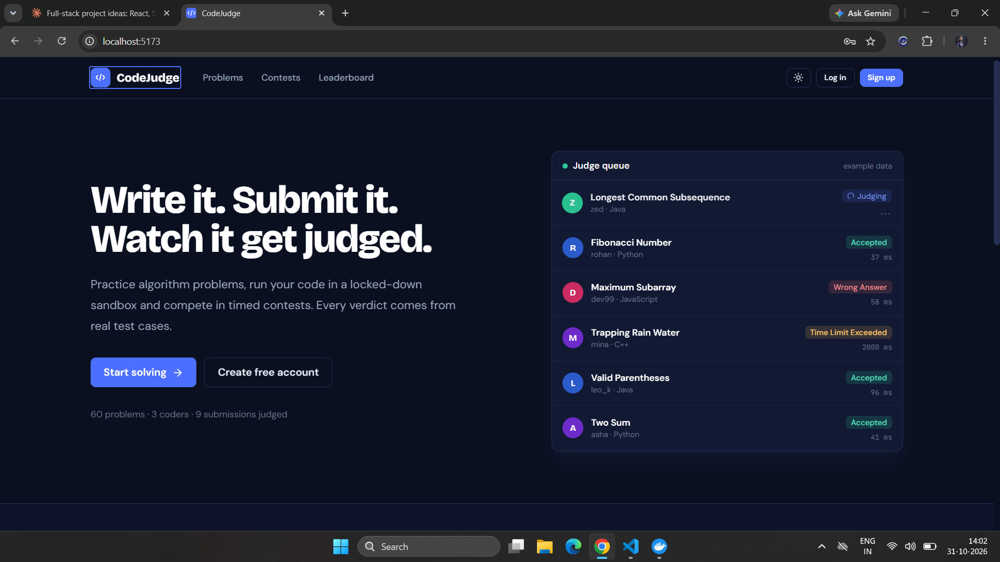
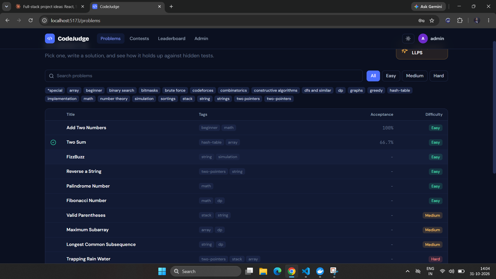
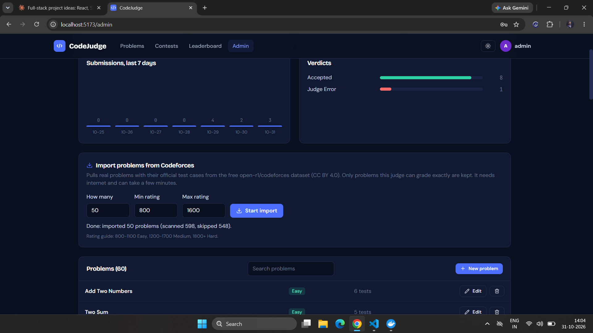
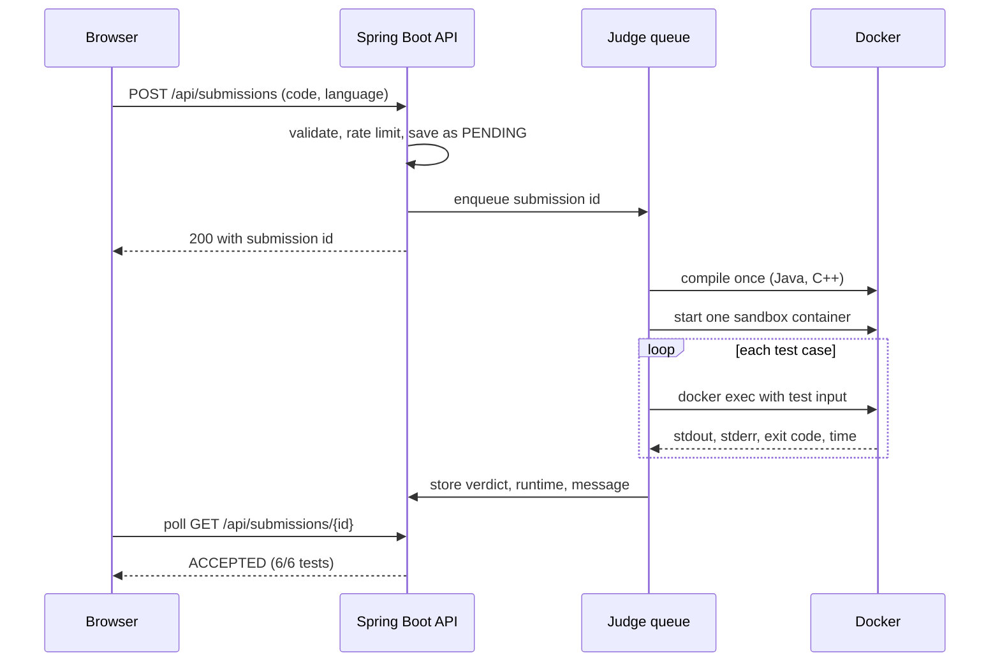
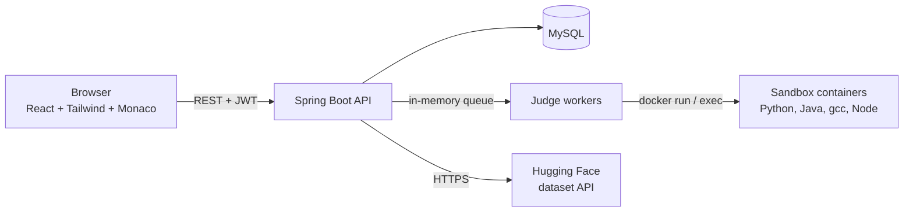

# CodeJudge

**An online code judge and contest platform.** Solve algorithm problems in Python, Java, C++ or JavaScript, run your code in a locked-down Docker sandbox, and compete in timed contests with a live leaderboard.




## Screenshots

| Problem list with search, filters and tags | Admin panel: import real Codeforces problems |
|---|---|
|  |  |

<!--
Add these after you take the screenshots, then delete this comment markers:
| Editor with an Accepted verdict | Contest leaderboard |
|---|---|
|  |  |
-->

## What this project demonstrates

- **Secure execution of untrusted code**: every submission runs in a Docker container with no network, memory, CPU and process limits, dropped Linux capabilities and a read-only code mount.
- **Full-stack engineering**: React SPA, REST API with Spring Boot, relational data model in MySQL, JWT authentication with roles.
- **Concurrency and background work**: submissions go through a queue and a fixed pool of judge workers; unfinished work is re-queued after a restart.
- **Real data pipeline**: an admin-triggered importer pulls problems with official test cases from an open dataset through a public API and converts them to the platform's format.
- **Product thinking**: contests with ICPC scoring, profile stats and heatmap, daily problem, custom-input runs, autosaved editor, dark and light themes.
- **Security basics done properly**: BCrypt, stateless JWT, role-based access, rate limiting, input validation, secrets kept in a git-ignored `.env`.

## Features

**For coders**
- Problem list with search, difficulty filter, tag filter, pagination, solved and attempted markers, acceptance rate and a daily problem
- Monaco editor (the editor behind VS Code) with starter templates, autosave per problem and language
- **Run** with custom input, **Submit** against hidden test cases with live verdict updates
- Verdicts: Accepted, Wrong Answer, Time Limit Exceeded, Memory Limit Exceeded, Runtime Error, Compilation Error
- Submission history with code viewer
- Profile: global rank, solved by difficulty, acceptance rate, streaks, language stats, one-year submission heatmap
- Global leaderboard

**Contests**
- Register, countdown timer, problems hidden until the start time
- ICPC-style ranking: most problems solved first, then lowest penalty (minutes to solve plus 20 for each wrong attempt)
- Leaderboard refreshes automatically while the contest is running

**For admins**
- Dashboard with totals, a 7-day submission chart and verdict distribution
- Problem editor with Markdown preview and sample and hidden test cases
- Contest editor
- **One-click import** of Codeforces problems with official tests (see below)

## How a submission is judged



The sandbox flags:

| Protection | Flag |
|---|---|
| No network | `--network none` |
| Memory limit (no swap) | `--memory` and `--memory-swap` set to the problem's limit |
| One CPU | `--cpus 1` |
| Fork bomb protection | `--pids-limit 256` |
| No Linux capabilities | `--cap-drop ALL` and `--security-opt no-new-privileges` |
| Code is read-only | volume mounted with `:ro` |
| Small scratch space | `--tmpfs /tmp:rw,size=64m` |
| Cleanup | the container is removed after the submission; a timeout kills it |

Starting one container per submission and running every test case inside it with `docker exec` is much faster than starting a new container for each test case.

## Architecture



| Layer | Technology |
|---|---|
| Frontend | React 18, Vite, Tailwind CSS 3, React Router, Axios, Monaco editor, KaTeX for math |
| Backend | Java 21, Spring Boot 3.5, Spring Security (JWT), Spring Data JPA, Bean Validation, springdoc OpenAPI |
| Database | MySQL 8 |
| Sandbox | Docker (python:3.12-alpine, eclipse-temurin:21-jdk-alpine, gcc:14, node:22-alpine) |

## Importing real problems

Under **Admin panel, Import problems from Codeforces**, choose a count and a rating range. The backend reads the open dataset [`open-r1/codeforces`](https://huggingface.co/datasets/open-r1/codeforces) (CC BY 4.0) through the free Hugging Face dataset API, and keeps only problems this judge can grade exactly:

- standard input and output
- a single correct answer (no special checker)
- not interactive
- no images in the statement
- complete official tests

Statements are converted to Markdown with LaTeX, difficulty is mapped from the Codeforces rating, and time limits are doubled because the originals are tuned for C++. Every imported statement keeps a source line crediting Codeforces and the dataset.

## API overview

Interactive docs: `http://localhost:8080/swagger-ui.html`

| Area | Endpoints |
|---|---|
| Auth | `POST /api/auth/register`, `POST /api/auth/login`, `GET /api/auth/me` |
| Problems | `GET /api/problems` (search, difficulty, tag, page), `GET /api/problems/{slug}`, `GET /api/problems/tags`, `GET /api/problems/daily` |
| Submissions | `POST /api/submissions`, `POST /api/submissions/run`, `GET /api/submissions/{id}`, `GET /api/submissions/mine` |
| Contests | `GET /api/contests`, `GET /api/contests/{id}`, `POST /api/contests/{id}/register`, `GET /api/contests/{id}/leaderboard` |
| Community | `GET /api/leaderboard`, `GET /api/users/{username}`, `GET /api/stats` |
| Admin (ADMIN role) | `/api/admin/stats`, `/api/admin/problems` (CRUD), `/api/admin/contests` (CRUD), `POST /api/admin/import`, `GET /api/admin/import/status` |

## Getting started

### Prerequisites
- JDK 21 and Maven 3.9 or newer
- Node.js 20 or newer
- MySQL 8 running locally
- Docker Desktop, running (it is used only to run submitted code)

### 1. Configure secrets
```bash
cp .env.example .env        # Windows: copy .env.example .env
```
Edit `.env` and set at least `DB_PASSWORD`, a `JWT_SECRET` of 32+ random characters, and `ADMIN_PASSWORD`. The `.env` file is git-ignored and must never be committed.

### 2. Start the backend
```bash
cd backend
mvn spring-boot:run
```
The database `codejudge` is created automatically. On the first start the app creates the admin account, 10 sample problems and 3 sample contests, and downloads the sandbox images in the background (the gcc image is large; remove `CPP` from `JUDGE_LANGUAGES` to skip it).

### 3. Start the frontend
```bash
cd frontend
npm install
npm run dev
```
Open http://localhost:5173 and log in as `admin@codejudge.local` with your `ADMIN_PASSWORD`, then use the admin panel to import more problems.

### Configuration

| Variable | Purpose | Default |
|---|---|---|
| `DB_HOST`, `DB_PORT`, `DB_NAME` | MySQL connection | `localhost`, `3306`, `codejudge` |
| `DB_USER`, `DB_PASSWORD` | MySQL credentials | `root`, none |
| `JWT_SECRET` | Token signing key (32+ characters) | none, required |
| `JWT_EXPIRATION_MS` | Token lifetime | `86400000` (24 hours) |
| `ADMIN_USERNAME`, `ADMIN_EMAIL`, `ADMIN_PASSWORD` | First admin account | `admin`, `admin@codejudge.local`, none |
| `CORS_ORIGINS` | Allowed frontend origins | `http://localhost:5173` |
| `JUDGE_WORKERS` | Submissions judged in parallel | `2` |
| `JUDGE_LANGUAGES` | Enabled languages | `PYTHON,JAVA,CPP,JAVASCRIPT` |
| `JUDGE_PREPULL` | Download sandbox images at startup | `true` |
| `JUDGE_STARTUP_ALLOWANCE_MS` | Extra time allowed for container start-up | `1500` |

### Tests
```bash
cd backend && mvn test
```

## Project structure

```
code-judge-platform/
  .env.example           template for secrets (the real .env is git-ignored)
  backend/
    src/main/java/com/codejudge/
      config/            security, properties, data seeding
      controller/        REST controllers
      domain/            JPA entities and enums
      dto/               request and response records
      judge/             Docker sandbox, judge workers, output comparison
      repository/        Spring Data repositories
      security/          JWT service and filter
      service/           business logic, contests, stats, problem import
  frontend/
    src/
      api/               Axios client
      components/        shared UI, navbar, heatmap
      context/           auth and theme state
      pages/             problems, editor, contests, profile, admin
```

## Design decisions and trade-offs

- **In-memory queue instead of RabbitMQ or Kafka.** One command starts the whole system. Unfinished submissions are re-queued on restart. For several servers, this would move to a message broker.
- **Polling instead of WebSockets.** The browser asks for the verdict every second, which is simple and robust. WebSockets would reduce requests.
- **Schema managed by Hibernate (`ddl-auto=update`).** Convenient for development. For production I would use Flyway migrations.
- **Runtime is wall-clock time including `docker exec`.** It is approximate, so time limits get a small start-up allowance.
- **JWT is stored in `localStorage`.** Simple for a single-page app; httpOnly cookies are safer for production.
- **Exact output comparison** (ignoring trailing spaces and blank lines). Problems that accept several valid answers need a custom checker, so the importer skips them.

## Roadmap

- WebSocket live verdicts
- Redis cache for leaderboards
- Custom checkers for problems with multiple valid answers
- Editorials and discussion per problem
- Dockerfiles and deployment on a VPS
- Flyway migrations

## Credits and license

- Code: [MIT License](LICENSE).
- Imported problem statements and tests come from the [`open-r1/codeforces`](https://huggingface.co/datasets/open-r1/codeforces) dataset (CC BY 4.0), and the problems originate from [Codeforces](https://codeforces.com). They remain the work of their authors and are credited on each problem page.
- Built by **RAHUL MAURYA** - [GitHub](https://github.com/Rahulmaurya1845) - [LinkedIn](https://www.linkedin.com/in/rahul-maurya-387b75314/)
